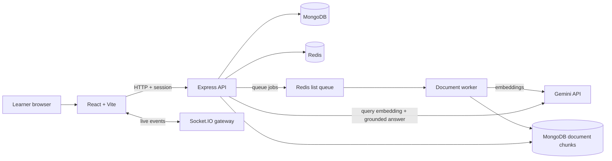

# Edventure

Edventure is a gamified learning platform with live quiz battles, server-verified quiz attempts, a private PDF study library, a document-grounded ERA tutor, and a topic mastery/mistake-review dashboard.

This fork's current development branch is `feature/edventure-2-security-foundation`. The security, RAG, and adaptive-learning code is under active development; it has CI coverage, but has not yet been load-tested or verified against a production AI provider account.

## Implemented features

- **Authentication and API hardening:** public-user DTOs, registration/login validation, rate limits, session cookies, origin restrictions, request-size limits, security headers and health endpoints.
- **Server-owned gamification:** course prices are enforced by the backend; the client-controlled point mutation route is retired; point-ledger events deduplicate score awards.
- **Verified quizzes:** owner-scoped attempts; answer keys are omitted from quiz start responses; the server calculates correctness and scores submitted option indexes.
- **Multiplayer quiz battles:** joins derive identity from the authenticated Passport session; answers must be sequential, timed on the server, and unique; answer keys are hidden until the game ends. Accepted answers and match summaries are persisted, and users can view their own match history.
- **ERA document tutor (RAG baseline):** upload a text-based PDF, retain page-aware chunks/embeddings, retrieve semantically and lexically relevant passages, and answer with source labels and page links. Document access is owner-scoped.
- **Adaptive learning:** a topic mastery estimate, private mistake notebook, review scheduling, and a dashboard based on server-verified generated-quiz answers.
- **Shared infrastructure:** Redis-backed fixed-window rate limits and sessions (when configured), an idempotent Redis-list document queue, retry/recovery behavior, a standalone worker command, Docker Compose, and GitHub Actions CI.

## Current limitations

- PDF text is extracted in the browser via PDF.js and posted to the backend; scanned/image-only PDFs, OCR, and server-side file scanning are not included yet.
- Retrieval uses a bounded MongoDB chunk scan with cosine similarity plus keyword overlap. It is not Atlas Vector Search yet, and no Recall@5/citation-quality results are claimed until the evaluation harness is run against a labelled dataset.
- The queue is a small Redis-list worker, not BullMQ. Deploying a separate worker requires `RUN_DOCUMENT_WORKER=false` on the API and running `npm run worker` in a worker process.
- Live matchmaking/game state is still held in process memory. Completed/active match summaries and accepted answers are persisted, but shared Redis matchmaking, Socket.IO scaling, restart recovery of active matches, and reconnect/resume are follow-up work.
- Topic mastery uses a simple confidence-adjusted accuracy estimate and accuracy-derived review intervals; it is not a clinical or research-validated learning measure.
- Real-provider integration and production load tests require your own credentials and infrastructure.

## Architecture



The intended starting point is a **modular monolith**, not a premature microservices rewrite. See [the security and roadmap notes](docs/SECURITY_AND_ROADMAP.md).

## Run locally (without Docker)

Requirements: Node.js 20+, MongoDB, and Gemini API credentials for AI quiz generation/RAG.

From the repository root:

```bash
cp backend/.env.example backend/.env
# Edit backend/.env: set MONGO_URI, a long random SESSION_SECRET,
# FRONTEND_URL=http://localhost:5173 and your Gemini key.
cd backend
npm ci
npm run check
npm test
npm start
```

In another terminal, from the repository root:

```bash
cd frontend
cp .env.example .env
# Ensure VITE_BACKEND_URL=http://localhost:5000
npm ci
npm run dev
```

Open [http://localhost:5173](http://localhost:5173). The backend API is at [http://localhost:5000](http://localhost:5000); health endpoints are `/health/live` and `/health/ready`.

If you use Redis locally, configure `REDIS_URL=redis://localhost:6379` in `backend/.env`. For hosted Upstash-compatible Redis, set `UPSTASH_REDIS_REST_URL` and `UPSTASH_REDIS_REST_TOKEN`. If no Redis configuration is present, local single-process fallbacks are used.

## Run with Docker Compose

Docker Compose provides MongoDB, password-protected Redis, the backend and the production-built frontend.

```bash
cp .env.docker.example .env
# Generate a strong password, e.g. with: openssl rand -hex 32
# Put it in the root .env as REDIS_PASSWORD=<generated-value>.
cp backend/.env.example backend/.env
# Set SESSION_SECRET and GEMINI_API_KEY in backend/.env.
docker compose config -q
docker compose up --build
```

Open [http://localhost:4173](http://localhost:4173). API port: `5000`. Stop the containers with `docker compose down`; named volumes preserve MongoDB and Redis data. To delete the data volumes as well, run `docker compose down -v`.

When operating the worker separately, set `RUN_DOCUMENT_WORKER=false` on the API and run `npm run worker` from `backend` in another process/container with the same MongoDB and Redis configuration.

## Environment and secret handling

- The frontend requires only `VITE_BACKEND_URL`.
- Keep Gemini/DeepSeek/API/session/database credentials on the backend. Never add provider keys as `VITE_*` variables because Vite embeds them in public frontend assets.
- If a provider key was ever configured as `VITE_GEMINI_API_KEY`, rotate it in the provider console before deploying this fork.
- Set `FRONTEND_URL` and `BACKEND_URL` to the actual hostnames in your deployment. Configure secure cookie settings and proxy trust to match your real reverse-proxy topology.
- Do not commit `.env`, `backend/.env`, database dumps, or real tokens.

## Verification

For labelled RAG retrieval evaluation, prepare a dedicated learner account with the benchmark documents, label relevant chunk IDs in `backend/evaluation/rag-cases.example.json`, then set `RAG_EVAL_USER_ID` and `RAG_EVAL_DATASET` before running `npm run evaluate:rag` from `backend`. The script reports Recall@5, MRR, nDCG@5, threshold-based abstention accuracy and retrieval latency percentiles; it does not invent faithfulness scores. Citation precision is only computed when cited/acceptable chunk IDs are explicitly annotated. Output defaults to `backend/evaluation/rag-results.json`.

The protected Prometheus endpoint is disabled by default. Set `METRICS_ENABLED=true` and a strong `METRICS_TOKEN` on the backend; call `/metrics` with `Authorization: Bearer <token>`. Metrics are process-local HTTP counters/histograms, not a distributed metrics backend.

The GitHub Actions workflow runs backend JavaScript syntax checks, unit tests, the frontend production build, and Docker Compose configuration validation. No hosted Redis or real AI provider integration is implied by those checks. Passing these checks does **not** replace a real-provider integration test, RAG quality evaluation, security review, or concurrent load test.

## Main API additions

- `POST /api/pdf-quiz` — authenticated server-side PDF quiz generation.
- `GET/POST/DELETE /api/documents` — list, index extracted PDF text, and delete the current user's documents.
- `POST /api/tutor/ask` — retrieve evidence from selected owned documents and return a cited answer.
- `POST /api/quiz-attempts/:attemptId/submit` — submit selected answer indexes; server calculates score.
- `GET /api/matches/history` — safe summary of the signed-in user's saved matches.
- `GET /api/learning/overview` — topic mastery and revision overview.
- `GET /api/learning/mistakes` — current user's mistake notebook.
- `POST /api/learning/mistakes/:mistakeId/review` — schedule a review.
- `POST /api/learning/mistakes/:mistakeId/resolve` — mark a mistake as learned.

